# Sara Ferraa

**Software Engineer** based in Casablanca, Morocco.

I build dependable backend systems, mobile products, and applied AI tools. My work spans Java and Spring Boot applications, React and Next.js interfaces, Flutter and React Native products, and enterprise technology.

I am currently a Software Engineering Intern at **Automai**.

[Portfolio](https://ferraasara.vercel.app) · [LinkedIn](https://www.linkedin.com/in/sara-ferraa-0aa73623a/) · [Email](mailto:ferraasara1@gmail.com)

## Selected work

### [AI Log Analyzer](https://github.com/sara0411/cybersec-log-analyzer)

A security-focused log classification project built from Syslog data, NLP preprocessing, and LSTM and BiLSTM sequence models.

**Evidence:** approximately 91.3% reported evaluation accuracy

**Technology:** Python, NLP, LSTM, BiLSTM

### [Recruitment CV Management Platform](https://github.com/sara0411/GestionCVForum)

A web application for managing candidate CVs and role-based recruitment workflows during recruitment forums.

**Technology:** C#, ASP.NET Core MVC, SQL Server

### SAM and ITAM E-Learning Platform

An internal learning platform covering ITAM fundamentals, IBM licensing and contracts, and CVA and SLR processes. I designed and built authentication, role-based learning modules, quizzes, manager validation, progress tracking, analytics, resources, and email notifications.

**Technology:** Java, Spring Boot, Thymeleaf, Spring Security, JPA, Hibernate, H2

**Availability:** private internal work

### [Personal Portfolio](https://github.com/sara0411/Portfolio)

My editorial portfolio, designed around a real portrait, factual project evidence, system-based light and dark themes, and scroll-linked motion.

**Technology:** Next.js, React, TypeScript

**Live:** [ferraasara.vercel.app](https://ferraasara.vercel.app)

## Experience

### Automai

**Software Engineering Intern · Current**

### Deloitte Extended Services Morocco

**IT and Software Asset Management Intern · Ended July 2026**

Worked with IBM software licensing environments, ILMT, BigFix, Passport Advantage concepts, ServiceNow SAM Pro, Flexera, USU, Active Directory, and enterprise reporting. I also built the internal SAM and ITAM learning platform described above.

### SLTVerse

**Software Engineer**

Contributed to fintech mobile and web products using React Native, Expo, TypeScript, Node.js, Express, Next.js, Supabase, and PostgreSQL. The work included payment, identity, blockchain, and real-time integrations.

### Attijariwafa Bank

**Software Developer**

Developed the recruitment CV management platform using ASP.NET Core MVC, C#, and SQL Server.

## Working set

### Backend and enterprise

### Web and mobile

### Data and delivery

## Education and credentials

**State Engineering Degree in Computer Science, Information Systems and Networks**

EMSI Casablanca, 2021 to 2026

- ServiceNow Certified System Administrator
- HCL BigFix Foundation
- Oracle Cloud Infrastructure DevOps

## Community

I have served as Co-Lead and Lead of **GDG on Campus EMSI Casablanca**, organizing technical workshops, developer events, and the OpportunAI hackathon. I have also supported career-oriented student programming as an **EMSI Career Center Ambassador**.

## GitHub activity

  
  

## Contact

For software engineering opportunities and project conversations, email [ferraasara1@gmail.com](mailto:ferraasara1@gmail.com).
